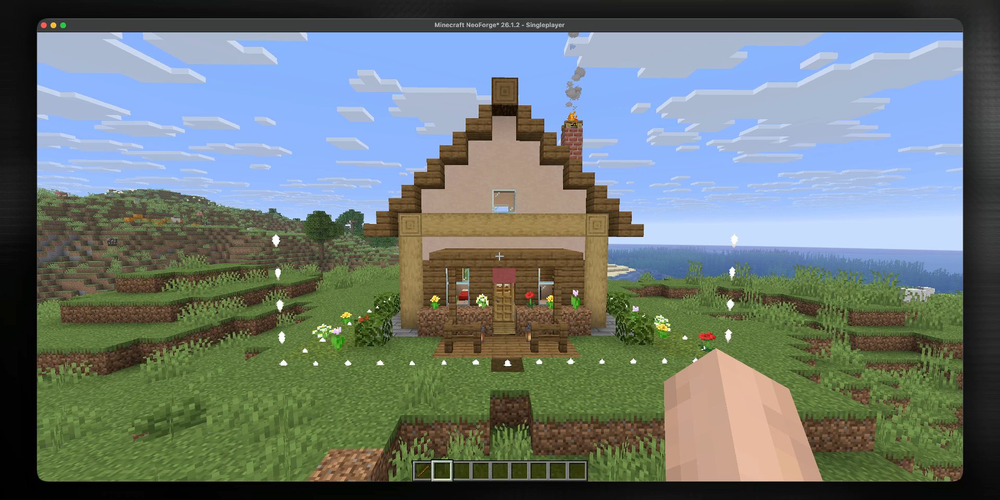
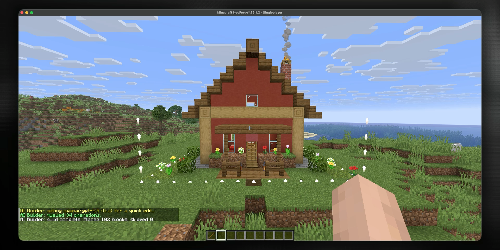
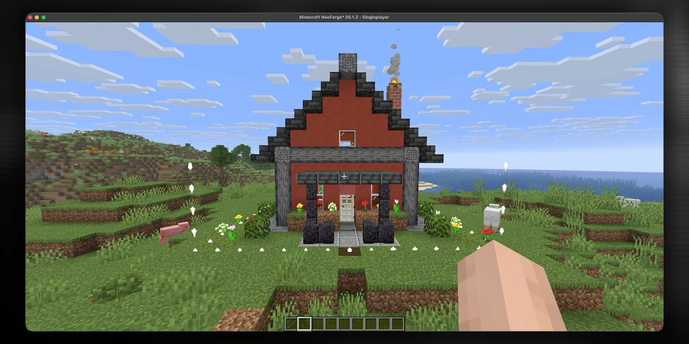
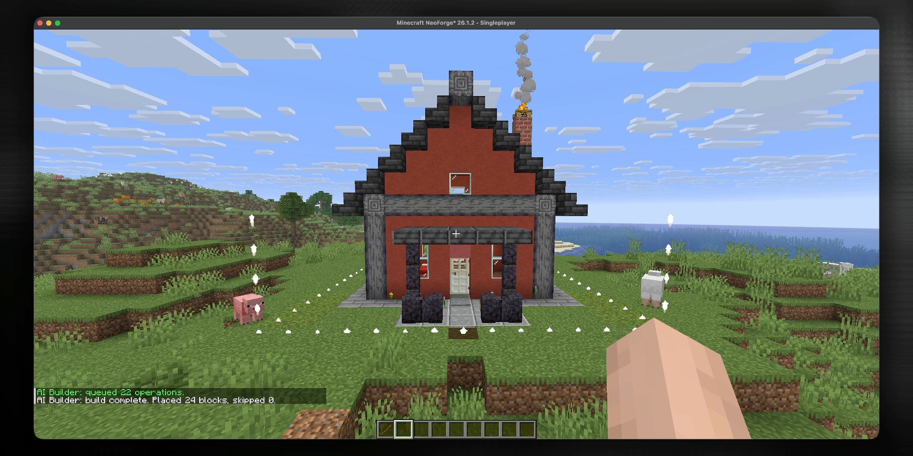

# Minedit

Minedit is an experimental NeoForge mod for building and editing Minecraft structures with AI models through OpenRouter or a local bridge for Codex or Cursor.

Select a footprint with a stick, describe what you want, and Minedit asks a model to generate compact builder code that places blocks in the selected area. It can also edit existing builds with compact line-aware patches, generate builds in focused stages, and run local bridge agent modes.

## Status and Risk

Minedit is a work in progress. Expect things to break.

This mod sends prompts to the provider you configure. OpenRouter requests use the API key you configure. Codex local bridge requests use your local Codex/OpenAI login and may consume Codex, ChatGPT, or OpenAI plan limits. Cursor local bridge requests use your local Cursor login or API key and may consume Cursor plan limits. Depending on your provider, model, account, and usage, requests may cost money or consume plan limits. You are responsible for all usage and charges caused by your configured provider. Use this mod at your own risk. The author is not responsible for unexpected costs, world changes, broken builds, broken saves, or other side effects.

Your OpenRouter API key is stored in plaintext in your Minecraft game directory at `config/minedit.properties`. It is not stored per-world. Do not share this file, screenshots of it, modpacks containing it, or support logs that include it. Alternatively, set the `OPENROUTER_API_KEY` environment variable before launching the game or server; it takes precedence over the saved key and keeps the key out of the config directory entirely.

Generated build code runs in a restricted JavaScript sandbox: it only sees the Minedit builder API (no Java classes, filesystem, or network access), is stopped after 30 seconds of execution, and is capped at 500,000 block operations per run. This limits what a bad model response can do, but it does not make large or broken builds safe for your world.

Back up worlds before testing large builds, staged builds, agent builds, or edits.

## Requirements

- Minecraft `26.1.2`
- NeoForge `26.1.2.73`
- Java 25 for development/building
- OpenRouter API key for OpenRouter mode
- Node.js 18+ and the Codex CLI for local Codex bridge mode
- Cursor CLI for local Cursor bridge mode

## Installation

You can either download a prebuilt jar from the GitHub Releases page or build it yourself.

### Download a Release

1. Download the latest jar from the [Minedit releases page](https://github.com/Angais/minedit/releases).
2. Copy the jar into your Minecraft `mods` folder.
3. Start the NeoForge profile.

### Build from Source

```sh
./gradlew build
```

Copy the jar from `build/libs/` into your Minecraft `mods` folder, then start the NeoForge profile.

## Quick Start

Minedit uses OpenRouter by default.

```mcfunction
/apikey <your-openrouter-key>
/model openai/gpt-5.5
```

Select two X/Z footprint corners by right-clicking blocks with a stick, then run:

```mcfunction
/build a detailed medieval blacksmith
```

Minedit uses the selected X/Z area as the footprint. Height is not capped by the selection.

When the second corner is selected, Minedit prints a short coordinate summary and a reusable `/selection set ...` command in chat. Save that command if you want to restore the same area later.

## Build Modes

### Normal Build

One model call generates the whole build:

```mcfunction
/build a cute house
```

Build mode clears existing non-air blocks in the selected footprint before placing the generated structure.

### Staged Build

Several focused model calls build the structure in phases:

```mcfunction
/build stages a detailed wizard tower
```

The staged builder currently runs these stages:

1. Foundation and frame
2. Walls, openings, doors, and windows
3. Roof, ceilings, stairs, and vertical access
4. Interior lighting and furniture
5. Exterior detail and landscaping
6. Final corrections and polish

Each stage receives the previous stage code as context and should only output incremental work for the current stage. This usually costs more than `/build`, but it gives the model more focus per phase.

### Local Agent Build

Agent modes work with the local bridge through Codex or Cursor:

```mcfunction
/provider codex-local
# or
/provider cursor
/build agent <prompt>
/build agent step-by-step <prompt>
```

`/build agent <prompt>` asks the local agent provider to draft, preview, and revise before Minecraft places the final build.

`/build agent step-by-step <prompt>` places the build in multiple visible steps. Codex uses Minedit dynamic tools such as `place_step`, `render_preview`, `inspect_status`, and `finish_build`. Cursor uses the bridge's phased step generator and emits placement batches as each phase completes.

## Editing

Use `/edit` to modify the selected area based on its current blocks:

```mcfunction
/edit make the roof steeper and add windows
```

Use quick edit for small targeted patches:

```mcfunction
/edit quick remove the flower and change the oak planks to spruce
```

Normal edit and quick edit use a compact line-aware representation of the current build, so models can emit small patches like `api.replaceLine(...)`, `api.clearLine(...)`, `api.set(...)`, or `api.fill(...)` instead of rebuilding unchanged geometry.

Set quick edit reasoning effort:

```mcfunction
/edit set quickeffort low
```

## Local Bridge

The local bridge lets Minecraft talk to `codex app-server` or Cursor CLI through a localhost HTTP server.

Requirements:

- Node.js 18+
- Codex CLI installed and logged in for `/provider codex-local`
- Cursor CLI installed and logged in for `/provider cursor`
- This repository or source zip available locally, because the bridge code lives in `bridge/`

Log in once if needed:

```sh
codex login
agent login
```

Start the bridge from the repository:

```sh
npm --prefix bridge start
```

The bridge listens on:

```text
http://127.0.0.1:8765
```

Then in Minecraft:

```mcfunction
/provider codex-local
/codexurl http://127.0.0.1:8765
/codex status
/model gpt-5.5
```

Codex model ids usually do not use the OpenRouter `openai/` prefix. The bridge strips `openai/` automatically, so `openai/gpt-5.5` becomes `gpt-5.5`, but setting `/model gpt-5.5` is clearer when using Codex.

For Cursor:

```mcfunction
/provider cursor
/codexurl http://127.0.0.1:8765
/model list cursor
/model auto
```

Cursor uses `agent -p --mode=ask` for normal build/edit/staged requests. Cursor model ids are the ids returned by `/model list cursor`, such as `auto` or account-specific ids like `gpt-5.5-medium`.

## Settings Commands

```mcfunction
/provider openrouter
/provider codex-local
/provider cursor
/apikey <openrouter-key>
/codexurl http://127.0.0.1:8765
/codex status
/openrouter provider list
/openrouter provider <provider-slug>
/openrouter provider auto
/model list cursor
/model <model-id>
/maxtokens <tokens>
/maxtokens default
/maxcompletiontokens <tokens>
/build export <prompt>
/build import
/selection import
/selection move here
/selection move <forward|back|left|right|up|down> [blocks]
/selection rotate [clockwise|counterclockwise]
/effort none
/effort minimal
/effort low
/effort medium
/effort high
/effort xhigh
/effort max
/streaming enabled
/streaming disabled
/stop
/minedit stop
/minedit stop <player>
/status
/usage <openrouter-generation-id>
```

Defaults:

```text
provider: openrouter
OpenRouter inference provider: automatic
model: openai/gpt-5.5
normal effort: medium
quick edit effort: low
max completion tokens: provider/model default
OpenRouter streaming: enabled
```

`/streaming enabled` streams OpenRouter responses and shows progress/reasoning summaries when the provider sends them. `/streaming disabled` waits for the full response before showing usage and queueing placement.

`/provider openrouter` selects OpenRouter as Minedit's AI transport. OpenRouter may still route a model across several inference providers. Use `/openrouter provider list` to see the provider slugs available for the current model, `/openrouter provider <slug>` to lock requests to one provider with no fallback, and `/openrouter provider auto` to restore OpenRouter's automatic routing. The selected slug is saved in `config/minedit.properties`.

`/maxtokens <tokens>` sets OpenRouter `max_completion_tokens`. `/maxtokens default` restores the current behavior, where Minedit omits the cap and lets the selected provider/model choose its default.

Not every model supports every reasoning effort (for example Claude Fable 5 goes up to `max` while GPT-5.5 tops out at `xhigh`). When the provider is OpenRouter, `/effort`, `/edit set quickeffort`, and `/model` check the selected model's supported efforts against OpenRouter's model metadata and warn you when your setting isn't supported, including the level OpenRouter will actually use — OpenRouter maps unsupported efforts to the nearest supported level rather than failing the request. The check is advisory and never blocks the command; if the lookup fails (offline, model unknown), the setting is saved as-is.

`/stop` requests cancellation for your current Minedit generation and removes your queued block placement jobs. It can interrupt OpenRouter streams and queued placement immediately. Codex and Cursor agent jobs are also cancelled through the local bridge when possible. `/minedit stop` does the same thing and always exists; on dedicated servers, where vanilla already owns `/stop` for shutting the server down, Minedit leaves vanilla `/stop` alone and only `/minedit stop` cancels Minedit work.

`/minedit stop <player>` lets operators (gamemaster permission) cancel another player's generations and queued placements, and is the form to use from the server console. The affected player is notified in chat.

Builds larger than about 10,000 blocks report placement progress in chat every 10 seconds. When several players have builds placing at once, the per-tick block budget is shared between them instead of processing one build at a time.

`/maxcompletiontokens` is an alias of `/maxtokens`.

`/status` shows the current provider, selected model, normal reasoning effort, quick edit reasoning effort, streaming setting, key/bridge configuration, current selection, active AI generations, and queued block placement jobs.

Settings are saved in `config/minedit.properties`. The OpenRouter API key in that file is plaintext and belongs to the whole Minecraft game directory/profile, not a single world. The local bridge URL and provider selection are also stored there. If you used an older build, Minedit will try to read the legacy `config/aibuilder.properties` file.

## Manual Export and Import

To use a model outside Minedit without making an in-game API call:

```mcfunction
/build export <prompt>
```

This writes the manual-build prompt to `config/minedit-debug/export-prompt.txt` and creates `config/minedit-debug/import-build.js` if needed. The import file starts with a footprint marker such as:

```javascript
// minedit-footprint: width=45 depth=54
```

Send the exported prompt to a model yourself, then paste the response below that marker. The prompt also tells the model to repeat the marker in its response, so the size remains attached to the imported code even if you replace the whole file.

To recover the exact footprint size—even after restarting the game—stand where you want its center and run:

```mcfunction
/selection import
```

This reads width and depth from `import-build.js` first, so deleting or replacing `export-prompt.txt` does not affect that import. For older import files without metadata, Minedit can also recognize hard-coded `w`/`d` values and otherwise falls back to the last compatible export prompt. Parameterized legacy code using `api.getWidth()`/`getDepth()` cannot reveal a deleted historical size, so add the marker manually if neither file still records it.

The recovered footprint is centered on the block under you. Before placing anything, you can reposition and rotate the preview:

```mcfunction
/selection move here
/selection move forward 5
/selection move left 2
/selection move up 1
/selection rotate
/selection rotate counterclockwise
```

`forward`, `back`, `left`, and `right` follow the direction you are currently facing. Cardinal directions (`north`, `south`, `east`, and `west`) also work. `/selection move here` recenters the footprint beneath your current position. Rotation stays centered and turns the imported geometry as well as directional block states such as stairs, doors, rails, signs, and side connections. The blue-flame corner in the selection preview marks the import's local `(0,0)`, so square footprints still show their orientation.

When the preview is where you want it, run:

```mcfunction
/build import
```

Minedit parses the imported response through the same build-code parser used for API responses, clears the selected footprint like normal build mode, and queues the resulting block operations. For very small snippets, `/build import <code>` also works, but the file workflow is safer for real generated builds.

## OpenRouter Usage and Cost

After OpenRouter builds/edits, Minedit prints usage data when available:

- input tokens
- reasoning tokens
- output tokens
- estimated cost or BYOK upstream inference cost
- model
- finish reason
- generation id

If OpenRouter's final generation metadata already includes cost, the first usage line includes it. Otherwise Minedit keeps checking in the background and sends a separate cost line when it becomes available. You can also run `/usage <generation-id>` to manually fetch the latest generation usage.

Minedit only displays usage fields. It does not print API keys.

OpenRouter streaming mode shows progress and provider-supplied reasoning summaries when available. It does not display raw hidden chain-of-thought.

## Reset Commands

Undo the last generated build/edit for your player:

```mcfunction
/reset build
```

Minedit keeps the last 5 build snapshots per player, so running `/reset build` repeatedly walks further back through your recent builds and edits. If a build is still placing blocks, `/reset build` cancels it first so the restore is not fighting live placement.

Clear the current selection:

```mcfunction
/reset selection
```

## Selection Commands

Recover the imported build's recorded footprint at your current position:

```mcfunction
/selection import
```

Move the selection to your current position or nudge it relative to where you are facing:

```mcfunction
/selection move here
/selection move forward [blocks]
/selection move back [blocks]
/selection move left [blocks]
/selection move right [blocks]
/selection move up [blocks]
/selection move down [blocks]
```

Rotate the selection and a subsequent imported build around its center:

```mcfunction
/selection rotate
/selection rotate counterclockwise
```

Teleport to the active selection:

```mcfunction
/selection tp
```

Restore the previous selection:

```mcfunction
/selection restore
```

Recreate a saved selection from the coordinate summary printed in chat:

```mcfunction
/selection set <x1> <y1> <z1> <x2> <y2> <z2>
```

## Examples

Model output depends on the model, effort setting, selected footprint, and surrounding world state. These examples show one generated build and three follow-up edits.

Build generation:

```mcfunction
/build a cute house
```



Quick edit:

```mcfunction
/edit quick make the walls red please
```



Quick edit:

```mcfunction
/edit quick can you please change the wood for stone? a cool one
```



Quick edit:

```mcfunction
/edit quick don't really like those plants outside, can you remove them?
```



## Debug Files

When a model response fails, Minedit writes debug files to:

```text
config/minedit-debug/
```

Useful files:

- `last-prompt.txt`
- `last-response.txt`
- `last-build.js`

These files may contain your prompts and generated code. They should not contain API keys, but review them before sharing.

## Notes on Generated Builds

Minedit prompts models to avoid common Minecraft placement problems such as unsupported plants, inverted roofs, stair orientation mistakes, unreachable stairs or ladders, missing landings, roof gaps, trapped doors, missing lintels/header blocks above doors, isolated pane/fence/wall slivers, blocked paths, cramped rooms, low ceilings, short support pillars, blocked window views, empty rooms, under-decorated upper floors, unlit interiors, and fragile blocks without support. It also prompts models to treat non-enterable builds such as statues, monuments, fountains, terrain features, vehicles, and decorative objects differently from houses. It also checks Minecraft block survival rules before placing blocks, so unsupported fragile blocks may be skipped.

Model output is still imperfect. Use `/reset build` and world backups while testing.

## Credits and Third-Party Technology

- Built with the NeoForge MDK template. The template files are MIT licensed by the NeoForged project; see `TEMPLATE_LICENSE.txt`.
- Uses NeoForge for Minecraft mod loading and APIs.
- Bundles Mozilla Rhino `1.8.0` as the JavaScript runtime through NeoForge Jar-in-Jar. Rhino remains licensed under the Mozilla Public License 2.0; its corresponding source and license details are listed in `THIRD_PARTY_NOTICES.md`.
- Uses OpenRouter's OpenAI-compatible chat completions API.
- Optionally uses the OpenAI Codex app-server through the local `bridge/` helper.
- Optionally uses Cursor CLI through the local `bridge/` helper.

## License

Minedit's original code, documentation, and assets are open source under the [MIT License](LICENSE).

Third-party components keep their original licenses. See [THIRD_PARTY_NOTICES.md](THIRD_PARTY_NOTICES.md) and [TEMPLATE_LICENSE.txt](TEMPLATE_LICENSE.txt) for details.
